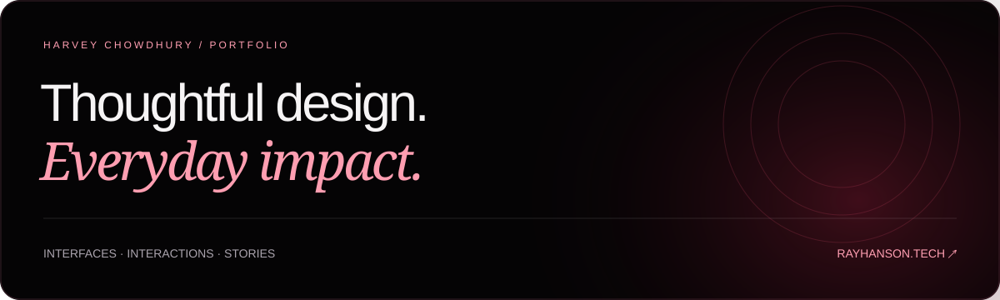

<a href="https://rayhanson.tech/">
  
</a>

<p align="center">
  <a href="https://rayhanson.tech/">
    
  </a>
</p>

<p align="center">
  <a href="https://rayhanson.tech/#work">Selected work</a> ·
  <a href="https://rayhanson.tech/#about">About me</a> ·
  <a href="mailto:Harvey@Rayhanson.tech">Get in touch</a>
</p>

Harvey Rayhanson’s portfolio, also known as Harvey Chowdhury. Exploring everyday experiences through visual design, AI, interactive projects, and sound. Built around a black and crimson palette, fluid motion, and clear paths into each project.

## Selected work

| Project | Focus | Explore |
| --- | --- | --- |
| **GymLog** | A workout companion that keeps set logging clear, quick, and easy to correct. | [Case study](https://rayhanson.tech/projects/gymlog/) · [Interactive prototype](https://rayhanson.tech/projects/gymlog/prototype.html) |
| **Studio Apartment Evening** | A 3:06 audio story built from 11 self-recorded sounds in Adobe Audition. | [Project and audio](https://rayhanson.tech/projects/studio-apartment-evening/) |
| **LeaveBy** | A workout transition planner that calculates when to stop, get ready, and leave for the next commitment. | [Project](https://rayhanson.tech/projects/leaveby/) · [Live app](https://leaveby.rayhanson.tech/) |

## The experience

- A horizontally scrolling hero with previews of every project, gentle automatic rotation, swipe, arrow, and keyboard controls.
- The carousel pauses during interaction and has its own pause control. Decorative animation automatically respects the device’s reduced-motion preference.
- Responsive project layouts, subtle section entrances, pointer highlights, and expandable GymLog screen previews.
- A dedicated contact section with email and copy controls: **[Harvey@Rayhanson.tech](mailto:Harvey@Rayhanson.tech)**.

## Navigation and future sections

The shared left rail expands on hover, keyboard focus, or its toggle. On mobile, the toggle opens a vertical drawer with an overlay, Escape support, and focus management. Home, Work, About, and Contact use real links; the homepage highlights the section currently in view.

To add another destination, such as Poetry, add a link to `.rail-links` on each page with a matching `data-section` and a real section ID or page URL. No tab-switching framework is required. Case studies use the same navigation and link back to the homepage sections.

`navigation.css` controls the rail and biography layout; `navigation.js` manages expansion, mobile behavior, and the active section.

## Run locally

Plain HTML, CSS, and JavaScript. No packages or build step required.

```sh
python3 -m http.server 8080
```

Open [localhost:8080](http://localhost:8080). You can also open `index.html` directly for a quick preview.

## Structure

| Path | Contents |
| --- | --- |
| `index.html` | Homepage, project showcase, about, and contact |
| `style.css`, `refinements.css`, `script.js`, `navigation.css`, `navigation.js` | Shared design and interactions |
| `projects/gymlog/` | Case study and working prototype |
| `projects/studio-apartment-evening/` | Audio story, process, recordings, and session screenshot |
| `projects/leaveby/` | App overview, previews, and live-app link |
| `assets/` | Interface illustrations, README artwork, and favicon |

Hosted on GitHub Pages at **[rayhanson.tech](https://rayhanson.tech/)**, deployed from `main` at the repository root. System fonts, no external dependencies, analytics, or trackers.

The GymLog prototype keeps sample workout changes in memory for the current session. LeaveBy uses entered time estimates and the device time zone; it does not use live transit data or save plans between sessions.

