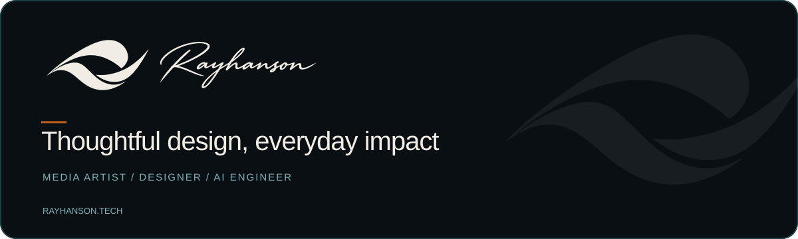
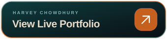
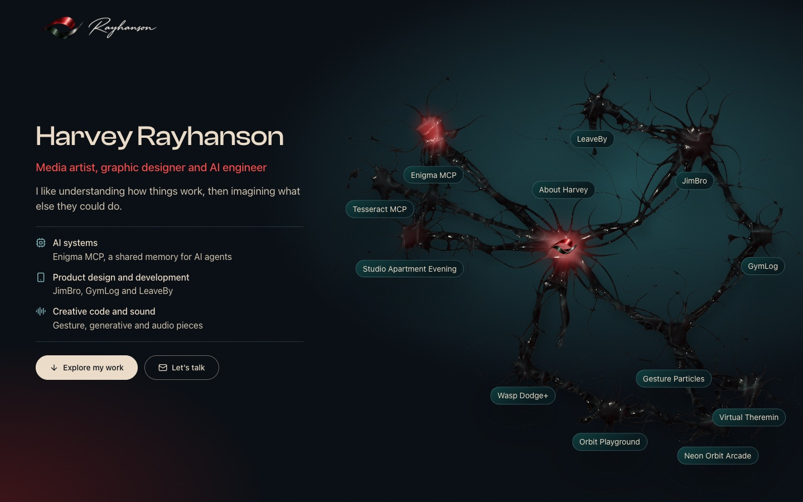

<a href="https://rayhanson.tech/">
  
</a>

<p align="center">
  <a href="https://rayhanson.tech/">
    
  </a>
</p>

<p align="center">
  <a href="https://rayhanson.tech/#work">Selected work</a> ·
  <a href="https://rayhanson.tech/#about">About me</a> ·
  <a href="mailto:Harvey@Rayhanson.tech">Get in touch</a>
</p>

Harvey Rayhanson’s portfolio: AI systems, product design, creative code and sound. Built around the Rayhanson identity: midnight navy, layered teals, warm cream and a hint of crimson, with a living web of projects behind the page.

<details>
<summary>Preview the portfolio</summary>

[](https://rayhanson.tech/)

</details>

## Selected work

| Project | Focus | Explore |
| --- | --- | --- |
| **Enigma MCP** | One Rust binary that gives AI agents a shared memory, kept as plain notes in an Obsidian vault. | [Case study](https://rayhanson.tech/projects/enigma/) · [Repository](https://github.com/Rayhanson-Git/enigma) |
| **JimBro** | LeaveBy scheduling and GymLog’s completed-set logging, unified in one persistent gym companion. | [Case study](https://rayhanson.tech/projects/jimbro/) · [Live app](https://jimbro.rayhanson.tech/) |
| **GymLog** | A workout companion that keeps set logging clear, quick, and easy to correct. | [Case study](https://rayhanson.tech/projects/gymlog/) · [Interactive prototype](https://rayhanson.tech/projects/gymlog/prototype.html) |
| **Studio Apartment Evening** | A 3:06 audio story built from 11 self-recorded sounds in Adobe Audition. | [Project and audio](https://rayhanson.tech/projects/studio-apartment-evening/) |
| **LeaveBy** | A workout transition planner that calculates when to stop, get ready, and leave for the next commitment. | [Project](https://rayhanson.tech/projects/leaveby/) · [Live app](https://leaveby.rayhanson.tech/leaveby) |
| **Neon Orbit Arcade** | A glowing particle playground where the cursor becomes an orb, clicks create portals, and a single key shifts the scene from calm to chaos. | [Project](https://rayhanson.tech/projects/neon-orbit/) · [Live experience](https://neon-orbit.rayhanson.tech/) |
| **Orbit Playground** | An interactive canvas of orbiting dots. Build new centers of motion, change the palette, and find a rhythm somewhere between stillness and speed. | [Project](https://rayhanson.tech/projects/orbit-playground/) · [Live experience](https://orbit-playground.rayhanson.tech/) |
| **Gesture Particles** | A browser-based particle system that turns hand gestures into scale, rotation, and color. Computer vision meets an evolving field of light. | [Project](https://rayhanson.tech/projects/gesture-particles/) · [Live experience](https://gesture-particles.rayhanson.tech/) |
| **Virtual Theremin** | A webcam instrument that maps hand movement to synthesized vocals, bass, and finger-tap drums, with visuals that follow the performance. | [Project](https://rayhanson.tech/projects/virtual-theremin/) · [Live experience](https://virtual-theremin.rayhanson.tech/) |
| **Wasp Dodge+** | A survival game built around a simple challenge: guide a wasp through moving circles and stay in play for as long as possible. | [Project](https://rayhanson.tech/projects/wasp-dodge/) · [Live experience](https://wasp-dodge.rayhanson.tech/) |
| **Tesseract MCP** (side contribution) | One merged pull request to Taimoor’s memory server for AI agents: atomic create-only writes and per-agent identity. | [Summary](https://rayhanson.tech/projects/tesseract/) · [Pull request](https://github.com/DeepExtrema/tesseract/pull/21) |

## The experience

- A black web drawn in WebGL sits behind the page and enters from the right. Each node is a project and a real link; strands pulse, reach for the pointer and drip. Point at a project button, a tile or one of the two opening buttons and a tendril takes hold of it. The view travels through the web as the page scrolls.
- Tiles and text fly in from the side as they scroll into view, overshoot and settle. Buttons hop on hover, and screenshots straighten and lift inside their tiles.
- A floating bar at the foot of the screen marks the section in view. A round control pauses all motion.
- The page works without JavaScript and without WebGL (the web becomes a plain list of links), and it respects the device’s reduced-motion preference.
- A contact section with email and copy controls: **[Harvey@Rayhanson.tech](mailto:Harvey@Rayhanson.tech)**.

## How it is put together

- `tokens.css` holds every colour, size and timing. `base.css` holds the resets. `home.css` holds the shared look: ground, tiles, buttons, links, floating bar, footer and entrances.
- `case.css` adds what only the case-study pages need. A project can add its own `project.css` after it.
- `scene.js` draws the web and moves the camera. `grip.js` makes the web's tendril take hold of the button or tile under the pointer, drawn with the same renderer on a small canvas above the page. `lift.js` brings a project tile forward when it is clicked, with a little more about the project. `home.js` handles entrances, the current link in the bar, hover lighting, copy buttons and GymLog’s screen dialog.
- To add a project to the web, add one `<a class="web__node" data-node="..." data-x data-y data-r>` in `index.html` and name it in a section’s `data-focus`.
- `tests/scene.test.mjs` covers the camera maths and `tests/grip.test.mjs` the grip's geometry: run `node --test tests/scene.test.mjs tests/grip.test.mjs tests/lift.test.mjs`.

## Rayhanson identity

The portfolio uses the supplied Rayhanson logo kit. The reflective logo appears in the corner of every page, on the centre node of the web and in the footer. Original aspect ratios and artwork are preserved.

- `assets/brand/` contains the selected original logo exports, icon sizes, and palette.
- `assets/favicon.svg`, `assets/brand/favicon.ico`, and `site.webmanifest` supply browser and home-screen icons.
- `assets/portfolio-banner.svg` and `assets/portfolio-share.png` carry the identity into GitHub and shared links.

## Run locally

Plain HTML, CSS, and JavaScript. No packages or build step required.

```sh
python3 -m http.server 8080
```

Open [localhost:8080](http://localhost:8080). You can also open `index.html` directly for a quick preview.

## Structure

| Path | Contents |
| --- | --- |
| `index.html` | Homepage: the web, the work, how I work, about and contact |
| `tokens.css`, `base.css`, `home.css`, `scene.js`, `grip.js`, `lift.js`, `home.js` | Shared design, the web, its grip, tiles brought forward, and interactions |
| `case.css` | Styles shared by the case-study pages |
| `projects/enigma/` | Enigma MCP case study, with install steps |
| `projects/tesseract/` | A short page on one contribution to another author’s project |
| `projects/jimbro/` | Unified gym companion case study, inspiration, project origins and working-app previews |
| `projects/gymlog/` | Case study and working prototype |
| `projects/studio-apartment-evening/` | Audio story, process, recordings, and session screenshot |
| `projects/leaveby/` | App overview, previews, and live-app link |
| `projects/neon-orbit/`, `projects/orbit-playground/`, `projects/gesture-particles/`, `projects/virtual-theremin/`, `projects/wasp-dodge/` | Creative coding, gesture, sound, and game project pages |
| `assets/` | Logo kit, project artwork, README artwork, and favicon |
| `style.css`, `refinements.css`, `script.js`, `navigation.css`, `navigation.js`, `brand.css`, `creative-projects.css` | The earlier design, kept but no longer loaded by any page |

Hosted on GitHub Pages at **[rayhanson.tech](https://rayhanson.tech/)**, deployed from `main` at the repository root. Fonts are Clash Display and Switzer from Fontshare. No packages, analytics, or trackers.

The GymLog prototype keeps sample workout changes in memory for the current session. LeaveBy uses entered time estimates and the device time zone; it does not use live transit data or save plans between sessions.


## Project domains

The five creative coding projects are deployed from their GitHub sources to Vercel, with individual CNAME records in Cloudflare. The portfolio remains on GitHub Pages. Existing GitHub Pages project URLs remain available. Vercel builds the two Vite projects with `npm run build -- --base=/`; their original Vite base paths remain intact for GitHub Pages. Wasp Dodge+ deploys only `Assignments/Midterm_Final_HarveyC` from the course repository.
